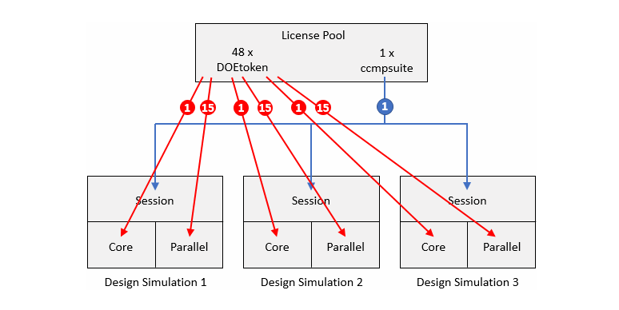
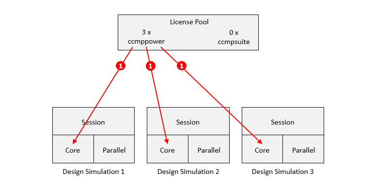

STAR-CCM+ Design Manager makes it possible to automatically orchestrate design exploration, DOE, and optimization campaigns from a single project. In practice, the study is described in a `.dmprj` file, and Design Manager then launches and drives the required simulations based on a reference simulation.

In our case, the project is `industrialExhaust_optimization.dmprj`, and it relies on the reference simulation `industrialExhaust_referenceSimulation.sim`, both stored in the `exhaust_opti/` folder. Running in batch mode means that everything happens without a graphical interface: the project is submitted, executed, and monitored automatically from a Python script.

In this article, we will:
- give a quick overview of the licenses you need to know about;
- clarify licenses needed at each workflow step, Design Manager schemes, and command-line options;
- compare the main licensing behaviors on the Design Manager side;
- then show how to launch the study on Qarnot with `-preallocpower`.

## Licenses: access on Qarnot

To run a STAR-CCM+ Design Manager study on Qarnot, you must grant us access to your license server. For more details, contact our team at <a href="mailto:support-compute@qarnot-computing.com" target="_blank">support-compute@qarnot-computing.com</a>.

From this point forward, we will assume that this configuration is already complete.

The guidance below is based on the Siemens <a href="https://docs.sw.siemens.com/documentation/external/PL20250327063586548/en-US/userManual/starccmp_userguide_html/STARCCMP/GUID-7873A15A-2776-4096-8AE3-142F2B7A3BA5.html" target="_blank">Design Manager Licensing</a> documentation.

## Licenses: the essentials before launching

Before going into licensing details, let us first define the Design Manager vocabulary:

- a **reference simulation** is the starting `.sim` file;
- a **design** is an individual simulation generated from that reference;
- a **study** is the full set of designs driven by Design Manager.

> In other words, `1 design = 1 simulation`, while `1 study = a set of simulations`.

### What this changes when launching

Before launching a Design Manager study, the main question is when each license resource can be used. This helps anticipate the most common blockers: the reference simulation cannot be read, the advanced study type is not authorized, or the designs cannot start because solver resources are missing.

#### 1. Licenses required at each Design Manager step

- **Reading or updating the reference simulation**: Design Manager needs a valid license :
  - `1 ccmpsuite`, `1 ccmppower`, or `10 powerpre` is required
- **Study setup**: no specific license
- **Analyzing or launching advanced studies** such as `Optimization`, `DOE`, or `Robustness and Reliability` : 
  - `1 innovatesuite` is required
- **Solver execution of the designs**: each design must have the required solver resources depending on the selected Design Manager mode and command-line options :
  - `X DOEtoken`, `1 ccmppower`, or `PoD` Power on Demand
- **Simulation with `In-cylinder` features** :
  - 1 `In-cylinder` license is required on the Design Manager server side.

#### 2. Command-line options and consumption scenarios

The launch options then choose how the designs consume the available resources:

- `-power`: requests Power Licensing for the design simulations;
- `-nosuite`: forces `DOEtoken` usage only, to avoid fallback to `ccmpsuite`;
- `-preallocpower`: enables Power pre-allocation on the Design Manager side (see below);
- `-dmnoshare`: enables General Job Submission mode (see below);
- `-passtodesign`: passes the options that concern the generated simulations to their own execution.

## The 3 Design Manager licensing behaviors

The solver consumption of a design is still made up of a `Session` part, a `Core` part, and `Parallel` components depending on the number of processors used. These components can be satisfied differently depending on the Design Manager scheme and the command-line options.

### 1. Default mode

In default mode, the Design Manager server checks out a `Session` license and shares it with the designs it launches. This session can be provided by a `ccmpsuite`, `ccmppower`, or Power on Demand license depending on your configuration.

The exact details of the `Core` and `Parallel` components then depend on your license portfolio and the consumption priorities configured in your environment. In many cases, the compute consumption associated with the designs uses `DOEtoken` first, with fallback possibilities depending on the other available options.

> The `-nosuite` flag forces `DOEtoken` usage for this consumption, which can be useful if you want to avoid using `ccmpsuite`.

Typical cases:

- you have a session license available for Design Manager and `DOEtoken` for running the designs;
- you want to limit the number of STAR-CCM+ sessions used during the study;
- you use a configuration close to the standard behavior documented by Siemens.

Example using 3 `ccmpsuite` and 48 `DOEtoken` from this <a href="https://docs.sw.siemens.com/documentation/external/PL20250327063586548/en-US/userManual/starccmp_userguide_html/STARCCMP/GUID-7873A15A-2776-4096-8AE3-142F2B7A3BA5.html" target="_blank">official documentation</a>:

### 2. General Job Submission with `-dmnoshare`

> **General Job Submission**, also called **Unlicensed Design Manager Server**, is enabled with `-dmnoshare`.

In this mode, Design Manager does not share a session license with the designs. Each design therefore starts more like a standard STAR-CCM+ simulation, with its own solver-side licensing scheme.

Typical cases:

- you mainly have `ccmppower` licenses and want the designs to use them directly;
- you use `PoD` and each design must start with the associated options;
- your designs have very different runtimes and you prefer resources to be released design by design as calculations finish.

Example using 3 `ccmppower` without `ccmpsuite` from this <a href="https://docs.sw.siemens.com/documentation/external/PL20250327063586548/en-US/userManual/starccmp_userguide_html/STARCCMP/GUID-7873A15A-2776-4096-8AE3-142F2B7A3BA5.html" target="_blank">official documentation</a>:

> Want to use it on Qarnot? Contact us for personalized support at <a href="mailto:support-compute@qarnot-computing.com" target="_blank">support-compute@qarnot-computing.com</a>.

### 3. Pre-Allocation with `-preallocpower`

> In the scripts for this article, we use `-preallocpower`.

This mode means that Design Manager reserves the required licensing resources in advance before launching the designs, from a single license pool.

> A license pool here means a set of licensing resources. You can have several pools on the same server, or several redundant servers for the same pool.

This mode is useful if you want to avoid surprises during the study. Instead of letting the designs start and only later discovering that a resource is missing, Design Manager validates license availability up front.

This predictability also has a trade-off: if a batch contains some very fast designs and others that run much longer, some resources can remain reserved while Design Manager waits for the end of the batch. This is especially visible in exploration or optimization studies, where Design Manager launches a group of designs, waits for their results, and then uses an algorithm to choose the next designs to explore.

Typical cases:

- you launch a long or costly study and prefer it to fail immediately if the licenses are not available;
- you run several designs in parallel and want more predictable license consumption;
- your designs have similar runtimes, so pre-allocation is unlikely to leave too many resources reserved unnecessarily;
- you launch on Qarnot and want a mode that is simple to automate in batch.

In other words, it is better to check up front that the study can start than to launch designs and fail later because licensing resources are missing.

In this example, we use Pre-Allocation mode because it is the simplest option to implement on Qarnot.

## Technical implementation on Qarnot

The batch launch relies on `starlaunch jobmanager`, which drives the Design Manager study and delegates the actual solving work to STAR-CCM+ simulations.

In the examples below, the scripts use STAR-CCM+ `20.04.008`. If you want to change version, simply adapt `DOCKER_TAG` in the script according to the versions available in the <a href="https://qarnot.com/en/software/starccm-qarnot" target="_blank">Qarnot software catalog</a>.

Before launching a calculation with the Python SDK, a few steps are required:

- <a href="https://app.qarnot.com/register" target="_blank">Create an account</a>
- Retrieve your <a href="https://app.qarnot.com/settings/access-token" target="_blank">API authentication token</a>
- <a href="https://doc.tasq.qarnot.com/documentation/sdk-python/installation.html" target="_blank">Install the Qarnot Python SDK</a>
- Know your Qarnot profile, for example `starccm-qarnot`

### Example case

If needed, you can directly download the two example files:

- <a href="https://communication.qarnot.com/hubfs/%5BMARCOM%5D%20Blog%20site%20HPC/starccm_DM/industrialExhaust_optimization.dmprj" target="_blank">industrialExhaust_optimization.dmprj</a>
- <a href="https://communication.qarnot.com/hubfs/%5BMARCOM%5D%20Blog%20site%20HPC/starccm_DM/industrialExhaust_referenceSimulation.sim" target="_blank">industrialExhaust_referenceSimulation.sim</a>

The expected working structure is:

<pre>
.
├── starccm_DM/
│   ├── exhaust_opti/
│   │   ├── industrialExhaust_optimization.dmprj
│   │   └── industrialExhaust_referenceSimulation.sim
│   ├── run_starccm_dm_batch.py
│   └── run_starccm_dm_batch_advanced.py
</pre>

The `.dmprj` file describes the Design Manager study. The `.sim` file is the reference simulation on which the study relies to create and run the different designs.

### Understanding the batch command

For the simple script on a single server, the useful command has the following form:

> starlaunch jobmanager --command "starccm+ -batch industrialExhaust_optimization.dmprj -preallocpower -passtodesign -power -licpath $CDLMD_LICENSE_FILE -mpi openmpi -np 26" --slots 0 --resourcefile /job/mpihosts

Here is the role of the main elements:

- `starlaunch jobmanager`: launches the Design Manager job manager that orchestrates the study and distributes the designs.
- `--command`: provides the STAR-CCM+ command that the job manager will run for the designs.
- `starccm+ -batch industrialExhaust_optimization.dmprj`: opens the Design Manager project without a graphical interface.
- `-preallocpower`: enables Pre-Allocation mode on the licensing side.
- `-passtodesign`: passes execution and licensing options to the simulations generated by Design Manager.
- `-power`: requests Power Licensing mode for the solver runs.
- `-licpath $CDLMD_LICENSE_FILE`: indicates where to find the license server.
- `-mpi openmpi`: selects the MPI implementation used for parallel execution.
- `-np 26`: sets the total number of MPI processes.
- `--slots 0`: lets the job manager rely on the provided resource file.
- `--resourcefile /job/mpihosts`: gives the job manager the list of resources allocated to the job.

In the advanced script, you can then move to `-np 94` on a `96c` machine, while keeping a few cores free for the system and MPI communications.

## Scripts

### Simple script on one server

The first script is intentionally lightweight. It targets a simple launch on a single server with `OnDemandScheduling`, using `26` cores out of `28` to leave some headroom for the system and communications.

### Advanced batch script

The second script follows the same logic with more options and comments. Here, it uses an EPYC `96c` processor in single-node mode.

## Results

You should now have an `industrial-exhaust-opti-out` folder in your working directory if you use the simple script, or an `industrial-exhaust-opti-advanced-out` folder if you use the advanced script. The same output bucket is also available on the <a href="https://app.qarnot.com/my-simulations" target="_blank">HPC</a> app with all the files generated by the study.

You can directly view some images and log files generated by the simulation from your output bucket on the <a href="https://app.qarnot.com/my-simulations" target="_blank">HPC</a> app.

Your results are stored in the output bucket defined in the script and can be retrieved in three ways:

- through the web platform, with direct download from the Bucket section;
- as shown in the Python script, using the <a href="https://doc.tasq.qarnot.com/documentation/sdk-python/api/compute/task.html#qarnot.task.Task.download_results" target="_blank">download_results</a> function;
- through one of the <a href="https://qarnot.com/documentation/manage-data-dedicated-ui" target="_blank">open-source S3 bucket management applications</a>.

For a large number of files or more than `5 GB` of data, we recommend using `rclone` on Linux or `Cyberduck` on Windows.
